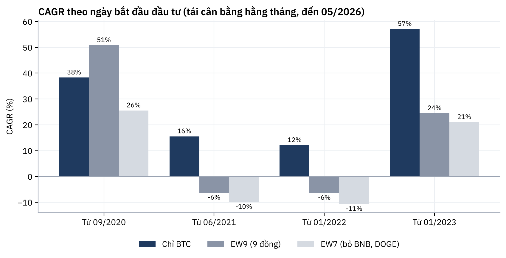
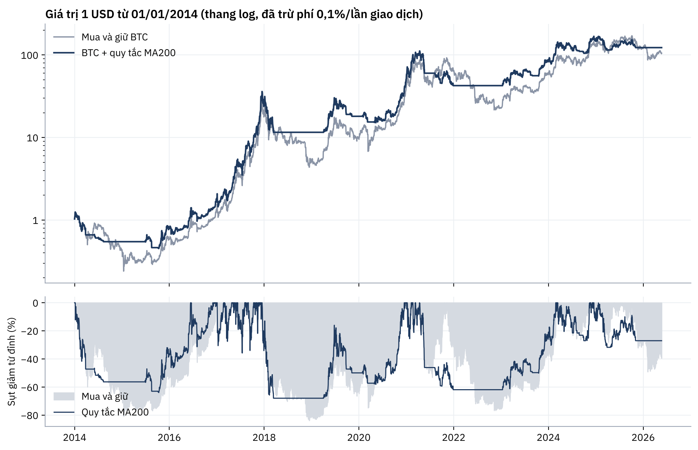

# Thị trường crypto 2020–2026: rủi ro, đa dạng hoá và quy tắc giao dịch đơn giản

**Báo cáo đầy đủ:** [report/Crypto_Market_Report.pdf](report/Crypto_Market_Report.pdf)
**Notebook:** [crypto_market_analysis.ipynb](crypto_market_analysis.ipynb)

## 1. Bài toán

Một nhà đầu tư muốn đưa crypto vào danh mục. Bốn câu hỏi cần trả lời bằng dữ liệu:

1. Rủi ro thật sự của crypto lớn đến đâu?
2. Mua nhiều đồng (đa dạng hoá) có tốt hơn chỉ giữ Bitcoin không?
3. Có quy tắc đơn giản, kiểm chứng được nào giảm sụt giảm mà không mất nhiều lợi nhuận?
4. Dữ liệu on-chain (MVRV) có cho biết BTC đang rẻ hay đắt không?

## 2. Dữ liệu

[Coin Metrics Community Data](https://github.com/coinmetrics/data): giá đóng cửa ngày (USD), vốn hoá, MVRV.

- `data/crypto_prices.csv`: 9 đồng (BTC, ETH, BNB, XRP, ADA, DOGE, LINK, LTC, DOT) và vốn hoá USDT, USDC, 20/08/2020 – 23/05/2026.
- `data/btc_onchain.csv`: giá, vốn hoá, MVRV, địa chỉ hoạt động, số giao dịch, hashrate của Bitcoin, 2010 – 2026.

Kiểm tra: không thiếu ngày, không có giá trống hoặc bằng 0; 15 ngày biến động trên 40% đều khớp sự kiện có thật nên giữ lại. Mẫu có **thiên lệch sống sót** (không có LUNA, FTT), nên kết quả rổ altcoin đẹp hơn thực tế.

## 3. Phương pháp

- Chỉ số rủi ro: CAGR, biến động năm hoá (×√365), Sharpe, sụt giảm tối đa, VaR 95%, beta với BTC.
- Tương quan theo trạng thái thị trường (10% ngày BTC giảm mạnh nhất / bình thường / 10% ngày tăng mạnh nhất).
- Danh mục tái cân bằng hằng tháng (chỉ BTC, chia đều 9 đồng, chia đều 7 đồng bỏ BNB và DOGE) với 4 ngày bắt đầu khác nhau.
- Backtest quy tắc MA200 trên BTC từ 2014: tín hiệu dịch 1 ngày để không dùng thông tin tương lai, phí 0,1%/lần, kiểm tra theo giai đoạn và theo độ dài MA.
- Lợi nhuận BTC 1 năm sau theo nhóm MVRV (2012 – 2025).

## 4. Kết quả chính

- **Rủi ro rất cao, kể cả với BTC:** biến động 58%/năm, sụt giảm tối đa -77% (09/2020 – 05/2026); altcoin sụt 70–98%.
- **Đa dạng hoá sang altcoin không giảm rủi ro:** tương quan altcoin–BTC là 0,57 vào ngày thị trường sập so với 0,31 ngày tăng mạnh. Rổ 9 đồng chỉ thắng BTC nếu bắt đầu từ 09/2020, nhờ BNB và DOGE năm 2021; bắt đầu từ 06/2021 trở đi, BTC thắng mọi rổ.
- **Quy tắc MA200:** CAGR 47% so với 46% khi mua và giữ (2014–2026), sụt giảm tối đa -68% thay vì -84%; thua trong giai đoạn đi ngang 2018–2021.
- **MVRV:** khi < 1, BTC có lãi sau 1 năm trong 99% trường hợp; khi > 3, chỉ 46%, trung vị -9%. Ngày 23/05/2026 MVRV = 1,41 (trung tính).
- **Stablecoin:** vốn hoá USDT + USDC tăng từ 16 lên 265 tỷ USD.




## 5. Khuyến nghị

1. Chỉ phân bổ phần tiền chịu được mất 80%; BTC làm lõi 70–100% phần crypto.
2. Altcoin là khoản đầu cơ nhỏ có giới hạn, không phải công cụ đa dạng hoá.
3. Kiểm soát sụt giảm bằng quy tắc viết sẵn (MA200 hoặc tái cân bằng định kỳ); tăng tỷ trọng khi MVRV thấp, giảm khi MVRV > 3.

## 6. Chạy lại

```bash
pip install -r requirements.txt
jupyter notebook crypto_market_analysis.ipynb
```

Trên Google Colab: mở notebook, tải 2 file trong `data/` lên khi được hỏi (hoặc đọc thẳng từ GitHub của Coin Metrics).

*Phân tích học thuật, không phải lời khuyên đầu tư.*
